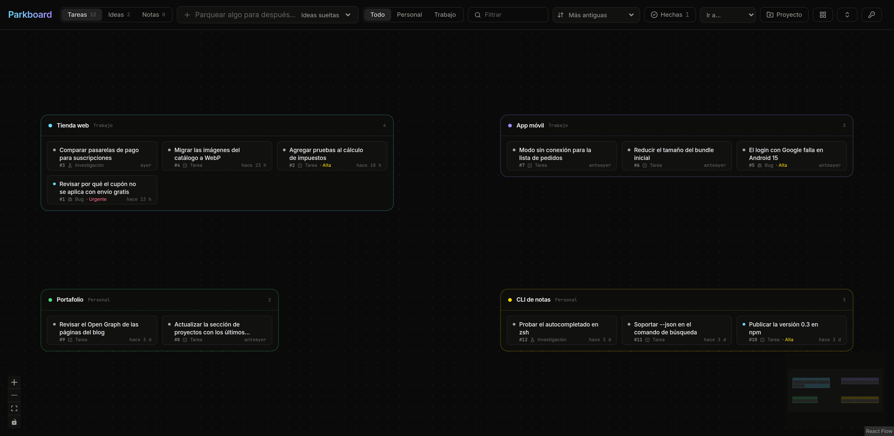
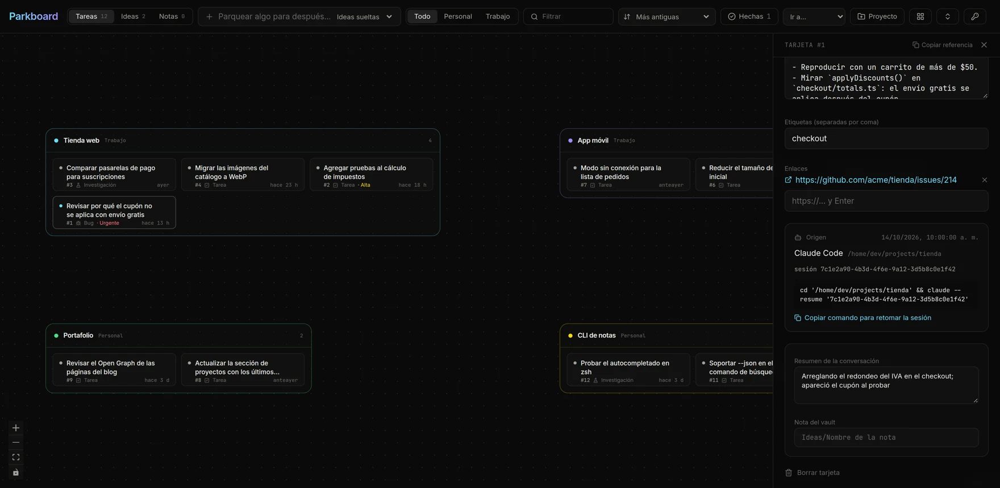

# Parkboard

An infinite canvas for the things you park for later: tasks, ideas, bugs and research, grouped by project,
with a CLI so your coding agents can park things for you when you say "let's leave that for later".

**Use it free at [parkboard.jato.run](https://parkboard.jato.run)** (sign in with Google) or host it yourself.



## Why

When you work with an AI agent (Claude Code, Codex or any other), one task keeps spawning others: a bug you spot
while fixing something else, an idea for later, a check you should run before shipping. You stay on the main
task, and by the end of the session those side tasks are lost in the conversation.

Parkboard keeps them in one place. The agent parks each one as it comes up, with enough context to pick it up cold
and a link back to the session where it was born. Every pending item stays visible on the canvas, and getting back
to it is one card away.

- **Canvas**: projects are groups that fit their cards; cards move between them by dragging. Each card has a short
  number (#12), status, priority, kind, notes, links, tags, and where it was born (origin and session).
- **Resume where it was born**: a card parked by Claude Code or Codex keeps the agent, the session id and the folder,
  and offers the command to reopen that conversation (`claude --resume <id>` or `codex resume <id>`).
- **Projects live while they have work**: parking into an unknown project creates it, and when its last open card is
  done, moved or deleted the project goes away (its done cards stay as loose ideas).
- **Tasks, Ideas and Notes views**: the canvas shows one at a time (bugs and research go with tasks), so ideas and notes do not crowd the work.
- **Personal and work areas**, text filter, and done cards out of the way in a Done panel grouped by day.
- **A GitHub repo per card** (`owner/name`): `park add` detects it from the git remote of the folder you park from,
  so a coding task always says where its code lives.
- **Activity dashboard** (`/dashboard`, the **Actividad** button): cards done and parked over any period, time to
  close, open cards over time, when you work, your year, breakdowns by project, kind, priority, area and origin, and
  an Autopilot panel. Done cards keep their project's name and color after the project is gone, so they still count.
- **Autopilot** (optional, [`autopilot/`](autopilot/README.md)): a scheduled worker that takes the cards you tag
  `auto`, solves them with Claude Code and opens a **draft** pull request for each one; only trivial changes go
  straight to `main`, tagged `auto-main`.
- **CLI `park`** with no dependencies: JSON when piped, `--dry-run` on writes, `park schema` for agents.
- **Encrypted at rest**: titles, notes, links, tags, project names and session details are stored with
  AES-256-GCM under a key kept outside the database (`PARKBOARD_ENCRYPTION_KEYS`), each value bound to its owner
  and field. Projects are found by a keyed hash of their slug (`PARKBOARD_INDEX_KEY`); text search decrypts in
  the server.
- **Private by default**: one board per Clerk user, plus an optional email allowlist (`PARKBOARD_ALLOWED_EMAILS`).
  The CLI uses API keys stored as SHA-256 hashes, and `park export` saves your whole board as JSON. See the
  [privacy policy](https://parkboard.jato.run/privacy).
- **Readable by agents and search engines**: `/llms.txt` and `/llms-full.txt` describe Parkboard, the CLI and the API
  for language models; `robots.txt` and `sitemap.xml` expose only the public pages.



Stack: Next.js 16, React 19, Tailwind 4, React Flow, Prisma 7 on Postgres, Clerk.

## Use it

Nothing to clone. The easy way is to let your agent (Claude Code, Codex, Gemini CLI, Cursor…) do it all:

> Set up Parkboard for me: read https://parkboard.jato.run/setup.md and follow it step by step.

[`/setup.md`](https://parkboard.jato.run/setup.md) tells the agent to install the CLI, run `park login` (you only
click **Authorize** in the browser) and save a standing rule in its own global instructions (`~/.claude/CLAUDE.md`,
`~/.codex/AGENTS.md`, `~/.gemini/GEMINI.md`…), so it parks things without being reminded. By hand:

1. ```bash
   curl -fsSL https://parkboard.jato.run/install.sh | sh     # macOS, Linux, WSL
   park login
   ```

   On Windows PowerShell, install with `irm https://parkboard.jato.run/install.ps1 | iex` (it goes to
   `%LOCALAPPDATA%\parkboard` and joins your user PATH), then open a new terminal and run `park login`.

   `park login` opens [parkboard.jato.run](https://parkboard.jato.run), you sign in with Google (your own empty board
   is created) and authorize the terminal; its key is saved in `~/.config/parkboard/config.json`. On a machine
   without a browser, open **CLI** on the board, create a key and run the `park config --url … --key pk_…` command
   it shows.

2. Give your agent the standing rule: copy the block between `<!-- parkboard:start -->` and `<!-- parkboard:end -->`
   in [`/setup.md`](https://parkboard.jato.run/setup.md) into the instructions it loads every session.

## Host it yourself

```bash
pnpm install
cp .env.example .env          # fill DATABASE_URL, Clerk keys, your email and an encryption key
pnpm exec prisma migrate deploy
pnpm dev
```

Losing `PARKBOARD_ENCRYPTION_KEYS` or `PARKBOARD_INDEX_KEY` means losing the data: keep a copy outside the
database, and keep retired keys for as long as backups written with them exist.

**Upgrading an existing board to encryption.** A version without encryption must never run next to one that
writes sealed rows, so the upgrade goes through a bridge:

1. Set both keys and `PARKBOARD_ENCRYPT_WRITES=false`, run `pnpm db:migrate` (additive) and deploy. This bridge
   reads both formats and writes in clear, so it runs safely next to the version before it.
2. Once the version before no longer serves any request, remove `PARKBOARD_ENCRYPT_WRITES` and deploy. The bridge
   still running next to it seals edits of sealed rows and never writes plaintext into one.
3. Once that deployment serves all traffic, run `pnpm encrypt:existing` until it exits 0. It stops if a project
   was created twice, and exits 1 if anything is left.

From then on, rolling back to a version without encryption shows sealed text: roll forward instead.

**Rotating the encryption key**, so that no instance ever meets a key it cannot read:

1. Deploy the ring `old:…,new:…` everywhere: every instance can now read `new`, still writing with `old`.
2. Once nothing runs with the previous ring, deploy `new:…,old:…`: new values use `new`.
3. Once nothing writes with `old` as the current key, run `pnpm encrypt:existing` until it exits 0.
4. Drop `old` from the running ring, keeping it safe for backups made before.

The index key is not rotated.

## CLI

On your own server, run `park login --url https://your-board.example.com`, or create keys from the web (**CLI**
button) or with `pnpm key:create <name> <clerk-user-id>`. From a clone, link the CLI with
`ln -s "$PWD/cli/park.mjs" ~/.local/bin/park`.

```bash
park config --url https://your-board.example.com --key pk_…
park add "Try surfacer on the recon report" -p google-flow --kind research --priority high
park ls                                  # open cards; -q text to search, -p project to filter
park show 12                             # everything about #12, including how to resume its session
park set 12 --status doing               # or --priority, --project, --title, --repo owner/name…
park done 12
park export > board.json                 # the whole board, done cards included
park project acme-crm --area work       # change a project's area (or --name to rename it)
park project acme-crm --delete --yes    # delete a project; its cards move to loose ideas
```

Agents: `park schema` prints every command, flag and exit code as JSON.

## API

All routes accept `Authorization: Bearer pk_…` or a Clerk session.

| Method | Path | |
|---|---|---|
| GET | `/api/board` | projects and cards |
| GET, POST | `/api/cards` | `?status=open\|idea\|pending\|doing\|done&project=&q=&limit=`, plus `tag=`, `tagPrefix=` and `withoutTagPrefix=` (these return every match) |
| GET, PATCH, DELETE | `/api/cards/:id` | the id or the short number; a PATCH with `ifUpdatedAt` only applies if the card was not changed since (409 otherwise) |
| GET, POST | `/api/projects` | |
| PATCH, DELETE | `/api/projects/:id` | deleting a project turns its cards into loose ideas |

## Autopilot

[`autopilot/`](autopilot/README.md) is a separate Node script with no dependencies, packaged as a Docker image to
run as a cron job (Parkboard's runs hourly on Railway). Each run picks one card tagged `auto` that is pending, has a
`repo` listed in [`autopilot/repos.json`](autopilot/repos.json) with its verifiers, and passes a fixed gate and a
triage; it then works the card in an isolated clone, checks the result and opens a draft PR. It also follows the PRs
it opened and tags the card `auto-pr-fusionado` or `auto-pr-cerrado` once GitHub says so. `node
autopilot/autopilot.mjs --dry-run` shows what it would do without changing anything. Details in its
[README](autopilot/README.md).
